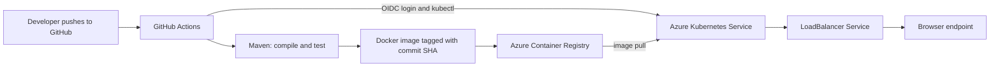

# CIA2 — End-to-End Cloud-Based CI/CD Pipeline

**Technical report draft — 4 November 2026**  
**Status:** Application build and test pass locally. Azure deployment is pending VM-family quota approval and GitHub-to-Azure identity configuration. Replace this status and add the requested screenshots after completing the live demonstration.

## 1. Problem definition

Manual build, test, container packaging, registry upload, and deployment steps are slow and difficult to repeat. This project automates those steps for a small Java task-board web application. A change pushed to the `master` branch is intended to trigger GitHub Actions, which verifies the Maven project, creates a Docker image, publishes it to Azure Container Registry (ACR), and updates an Azure Kubernetes Service (AKS) deployment.

The web application is a Spring Boot service. Its static task-board interface is served from the application, and its `/api/tasks` endpoints provide in-memory create, list, toggle, and delete operations. The project includes a Dockerfile, Maven wrapper and `pom.xml`, a Kubernetes Deployment and LoadBalancer Service, and a GitHub Actions workflow.

## 2. Architecture



The planned Azure resources are in the `cia2-azure-rg` resource group. The ACR named `cia2taskboard9472` was created in East Asia. The AKS cluster is configured in the portal as `cia2-aks-demo`, using the Free control-plane tier and one Linux node. Azure currently reports that the selected `Standard_D2as_v5` node needs 2 vCPUs from the Standard DASv5 family, while the subscription quota is 0. A quota request for a total limit of 2 was submitted and is under review. The cluster has not been created yet.

## 3. Tools and design choices

| Tool | Role in the solution |
| --- | --- |
| Git and GitHub | Source control and push event that starts the pipeline |
| Java 21, Maven Wrapper, Spring Boot | Build and test the Java application reproducibly |
| Docker | Package the application JAR into a portable image |
| Azure Container Registry | Store versioned application images |
| Azure Kubernetes Service | Run and orchestrate the application containers |
| GitHub Actions | Automate build, test, image publishing, deployment, and endpoint verification |
| Kubernetes YAML | Declare the application deployment and browser-facing service |

GitHub Actions is used because it is integrated with the source repository and can start from a push. Azure login is configured for OpenID Connect (OIDC), which avoids storing a long-lived Azure client secret in the repository. Ansible is not included: the pipeline directly applies Kubernetes manifests, and the project has no separate fleet of virtual machines requiring configuration management.

## 4. Pipeline stages

The workflow is `.github/workflows/ci-cd.yml`.

1. **Checkout:** fetches the commit that triggered the run.
2. **Build and test:** configures Temurin Java 21 and runs `./mvnw -B clean verify`.
3. **Azure authentication:** for pushes and manual runs, authenticates to Azure using GitHub OIDC and repository secrets.
4. **Image build and publish:** builds the Dockerfile and pushes `cia2-taskboard:<commit-sha>` to ACR.
5. **Kubernetes deployment:** gets AKS credentials, substitutes the exact image tag into the Deployment manifest, applies the Deployment and Service, and waits for the rollout.
6. **Availability check:** waits for the LoadBalancer external IP and sends an HTTP request to the application root.

Pull requests run the build and test stage without Azure credentials. Pushes to `master` and manual runs are intended to perform the full deployment. The GitHub repository must have the variables `ACR_NAME`, `AZURE_RESOURCE_GROUP`, and `AKS_CLUSTER_NAME`, and the secrets `AZURE_CLIENT_ID`, `AZURE_TENANT_ID`, and `AZURE_SUBSCRIPTION_ID`. The Entra application must trust this repository and branch through a federated credential and must have narrowly scoped permissions to push to ACR and deploy to AKS.

## 5. Deployment and test results

The local verification command was:

```text
./mvnw -B clean verify
```

**Result:** `BUILD SUCCESS`; 1 test run, 0 failures, 0 errors, 0 skipped. The Spring application context started and Maven packaged `target/aws-cicd-demo-0.0.1-SNAPSHOT.jar`. The Dockerfile copies that artifact into an Eclipse Temurin Java 21 runtime image and exposes port 8080.

**Cloud result:** not yet verified. The AKS cluster is blocked on quota approval. No successful GitHub Actions deployment, running Kubernetes pod, external IP, or public application endpoint is claimed in this draft. After the quota is approved, capture the workflow run, ACR image tag, AKS node/pod status, and browser page here.

## 6. Challenges and decisions

The initial AWS managed node group failed because the chosen EC2 instance type was not eligible for the account’s Free Tier. A smaller instance type also did not create successfully, and the EC2 Instances view showed no instance. The project therefore moved to the available Azure for Students subscription and its credit balance. The Azure Student subscription is not a guarantee that each selected VM size is available: the current AKS node pool is blocked by a zero regional VM-family quota. The quota request is awaiting Azure review.

Azure Cost Management budget thresholds provide notifications; they are not an automatic resource shutdown. The selected node’s portal estimate was about US$86.87 per month before other resources such as disks, registry storage, and the public load balancer. A ten-day run is not guaranteed to stay below a chosen credit limit until actual resource prices and the subscription balance are checked. Delete the project resource group after the demonstration and inspect Cost Management for any remaining resources.

## 7. Security, limitations, and cleanup

- Keep Azure identifiers in GitHub secrets/variables and never commit credentials or kubeconfig files.
- Prefer GitHub OIDC federation over a long-lived client secret; restrict its subject to this repository and deployment branch.
- Grant only the ACR push and AKS deployment permissions needed by the workflow.
- The task data is held in memory and resets when the application restarts; this is acceptable for a short demonstration, not persistent production use.
- The public LoadBalancer endpoint is appropriate for the class demo; a production system should add HTTPS, a domain, persistent storage, and stronger access controls.
- After evidence capture, delete `cia2-azure-rg` if it contains only this project’s resources, then confirm the registry, AKS resources, disks, and networking resources are removed and review the final cost view.

## 8. Evidence to add before submission

1. GitHub Actions successful run showing Maven tests, image push, deployment rollout, and HTTP endpoint verification.
2. ACR repository showing the image tagged with the commit SHA.
3. Azure portal view of the AKS cluster and a Ready node.
4. `kubectl get pods,service` output showing the pod Ready and the service external IP.
5. Browser screenshot of the deployed task board.
6. A second commit and successful run showing the changed page at the same endpoint.

Do not label the project fully deployed until these items are captured.
