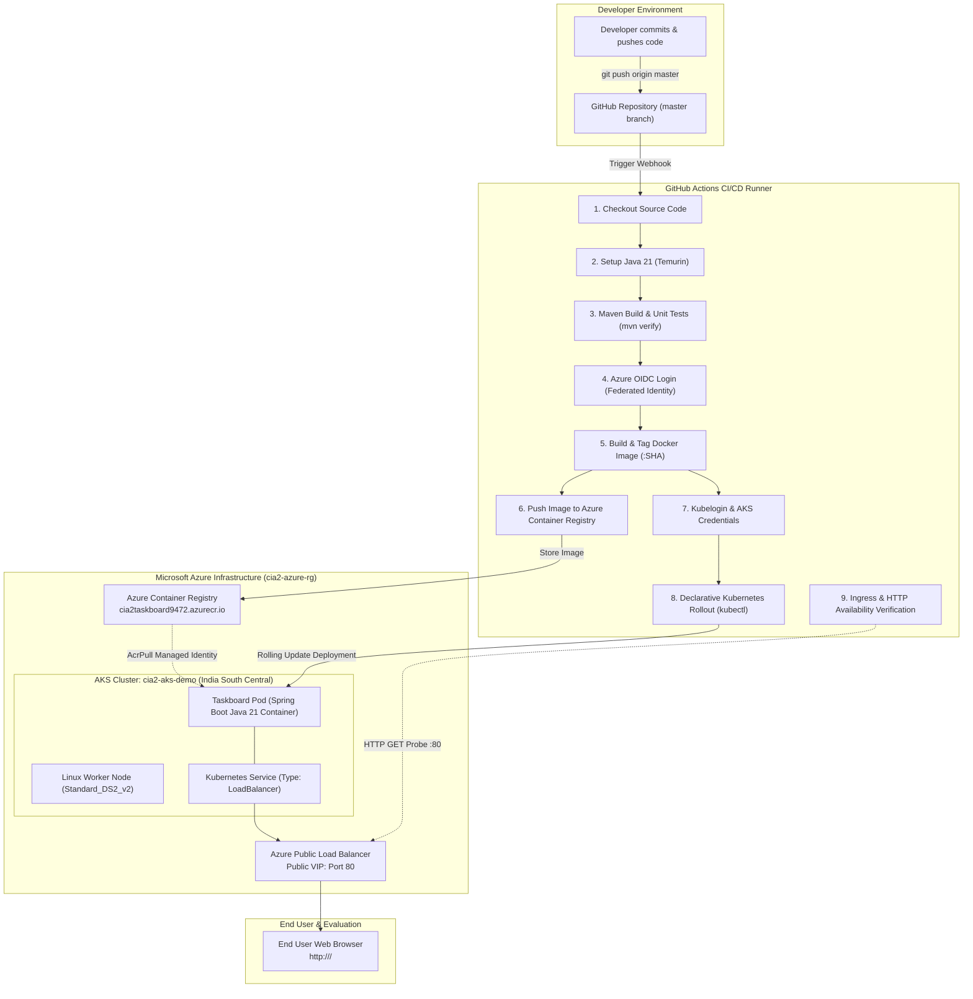

# CIA 2 Technical Report: Design and Implementation of an End-to-End Cloud-Based CI/CD Pipeline

**Course Component:** Continuous Integration & Continuous Deployment (DevOps)  
**Cloud Provider:** Microsoft Azure (Azure for Students)  
**Target Cluster:** Azure Kubernetes Service (AKS) — `cia2-aks-demo`  
**Registry:** Azure Container Registry (ACR) — `cia2taskboard9472`  
**CI/CD Orchestrator:** GitHub Actions  
**Repository:** [https://github.com/Seja-17/aws-cicd-demo](https://github.com/Seja-17/aws-cicd-demo)  
**Application:** Java 21 Spring Boot REST & Static Task Board Web Application  

---

## 1. Problem Definition & Objectives

Modern software engineering demands rapid, repeatable, and reliable delivery cycles. Traditionally, developers manually compiled Java source code, ran unit tests on heterogeneous developer machines, packaged JAR artifacts, built Docker container images, and pushed them to servers or orchestration clusters using manual CLI commands.

This legacy manual workflow presents severe bottlenecks:
1. **Inconsistency ("Works on my machine" syndrome):** Divergent local JDK versions, operating system environments, and build dependencies lead to packaging mismatches.
2. **Error-Prone Manual Steps:** Human errors during tagging, secret handling, or configuration management can corrupt deployments or leak credentials.
3. **Slow Delivery Velocity:** Manual regression testing and deployment handoffs cause prolonged release cycles.
4. **Lack of Reproducibility & Auditability:** No automated audit trail exists linking deployed production container images directly to source code commits.

### Project Objective
The objective of this project (CIA 2) is to design and implement an automated, production-grade, end-to-end Continuous Integration and Continuous Deployment (CI/CD) pipeline on Microsoft Azure. The pipeline automatically triggers upon code commits pushed to GitHub, compiles and unit-tests a Java 21 web application with Apache Maven, packages it into a minimal Docker container, publishes the immutable image to Azure Container Registry (ACR), deploys the workload onto an Azure Kubernetes Service (AKS) cluster, and verifies external HTTP service health with zero downtime.

---

## 2. End-to-End Architecture & Workflow

The architecture utilizes Git-driven automation coupled with Microsoft Azure cloud infrastructure and Kubernetes container orchestration:



### Flow Breakdown
1. **Source Trigger:** Developer pushes commits to the `master` branch of the GitHub repository.
2. **Build & Automated Verification:** A GitHub-hosted Ubuntu runner executes `mvn clean verify`, running unit tests for controller logic and context initialization.
3. **Passwordless Cloud Authentication:** The runner authenticates to Microsoft Entra ID via OpenID Connect (OIDC) federation, eliminating static cloud secrets.
4. **Containerization & Publishing:** Docker builds the container image and tags it with the unique git commit SHA (`${{ github.sha }}`). The image is pushed to ACR.
5. **Orchestrated Deployment:** The runner authenticates to AKS, updates the manifest image reference, and applies the declarative deployment.
6. **Self-Healing & Availability Verification:** The pipeline polls the Kubernetes LoadBalancer for an assigned public IP and performs automated HTTP health checks before completing the run.

---

## 3. Tool Selection & Justification

| Technology / Tool | Category | Role in Solution | Justification |
| :--- | :--- | :--- | :--- |
| **Git & GitHub** | Source Code Management | Version control and pipeline event trigger | Industry standard SCM with native webhook integration to trigger CI/CD workflows on push/PR events. |
| **Java 21 & Spring Boot 4** | Application Platform | High-performance backend & static web service | Long-Term Support (LTS) Java platform; Spring Boot provides rapid MVC endpoints, embedded Tomcat, and built-in health probes. |
| **Apache Maven (Wrapper)** | Build & Dependency Tool | Dependency resolution, compilation, unit testing | Bundled Maven wrapper (`mvnw`) guarantees identical build behavior across local developer workstations and CI runners. |
| **JUnit 5 & Spring Test** | Automated Testing | Unit testing REST controllers and context validation | Executes automated test suites during every CI run, preventing defective code from progressing to containerization. |
| **Docker** | Containerization | Packaging runtime dependencies and compiled JAR | Standardizes runtime environment into a lightweight, reproducible container image based on `eclipse-temurin:21-jre`. |
| **Azure Container Registry (ACR)** | Artifact Registry | Secure, private container registry (`Basic` SKU) | High-throughput cloud registry integrated with Microsoft Entra ID and AKS via managed identities. |
| **Azure Kubernetes Service (AKS)** | Orchestration | Automated scheduling, scaling, and rolling updates | Managed control plane (Free tier), self-healing container execution, declarative state management, and integrated cloud load balancing. |
| **GitHub Actions** | CI/CD Platform | Pipeline orchestration and automated execution | Hosted runners, tight GitHub integration, native OIDC federation with Azure, and declarative YAML workflow definitions. |
| **Kubelogin** | Cloud Authentication Plugin | Non-interactive AKS authentication for `kubectl` | Enables seamless Microsoft Entra ID authentication on Azure RBAC-enabled AKS clusters from CI/CD runners without interactive prompts. |
| **Ansible** | Configuration Management | Infrastructure & deployment automation asset | Provides declarative playbooks (`ansible/deploy-k8s.yml`) and host inventories (`inventory.ini`) for repeatable deployment automation. |

---

## 4. CI/CD Pipeline Implementation & Detailed Stages

The CI/CD pipeline is implemented in `.github/workflows/ci-cd.yml` and consists of 7 sequential stages:

### Stage 1: Checkout Source Code
Uses `actions/checkout@v6` to pull the exact commit that triggered the workflow into the runner's workspace.

### Stage 2: Java Environment & Maven Verification
Uses `actions/setup-java@v6` to configure Eclipse Temurin JDK 21 with built-in Maven dependency caching. The runner executes:
```bash
./mvnw -B clean verify
```
This compiles all Java source classes, verifies resources, and executes unit tests (including `TaskControllerTest` and Spring Boot context verification). If any test fails, the pipeline terminates immediately, preventing broken code from propagating.

### Stage 3: Passwordless Azure Authentication (OIDC)
Rather than storing permanent Azure Service Principal credentials or client secrets in GitHub, authentication utilizes OpenID Connect (OIDC) through `azure/login@v2`:
```yaml
- name: Log in to Azure with GitHub OIDC
  uses: azure/login@v2
  with:
    client-id: ${{ secrets.AZURE_CLIENT_ID }}
    tenant-id: ${{ secrets.AZURE_TENANT_ID }}
    subscription-id: ${{ secrets.AZURE_SUBSCRIPTION_ID }}
```
Microsoft Entra ID validates the cryptographic token issued by GitHub Actions against a federated identity credential configured for the repository and branch.

### Stage 4: Docker Image Build & ACR Push
The runner authenticates to the Azure Container Registry using `az acr login --name $ACR_NAME`. It tags the Docker image with the unique commit SHA to ensure immutable, traceable artifacts:
```bash
IMAGE="$ACR_NAME.azurecr.io/cia2-taskboard:$GITHUB_SHA"
docker build --tag "$IMAGE" .
docker push "$IMAGE"
```

### Stage 5: AKS Authentication & Kubelogin
The runner acquires AKS cluster credentials and converts the kubeconfig for non-interactive Azure CLI execution:
```bash
az aks get-credentials --resource-group "$AZURE_RESOURCE_GROUP" --name "$AKS_CLUSTER_NAME" --overwrite-existing
kubelogin convert-kubeconfig -l azurecli
```
This step is critical: it prevents interactive web-browser login prompts on headless CI runners.

### Stage 6: Declarative Kubernetes Deployment
The pipeline dynamically parameterizes `k8s/deployment.yaml` with the freshly pushed image tag and applies it:
```bash
sed "s|__IMAGE__|$IMAGE|g" k8s/deployment.yaml | kubectl apply -f -
kubectl rollout status deployment/taskboard --timeout=180s
```
Kubernetes initiates a rolling update, spawning new pods with the updated image and terminating old pods only after readiness probes pass.

### Stage 7: Automated Endpoint & Availability Verification
The workflow continuously queries the Kubernetes Service until the Azure Public Load Balancer provisions an external IP. Once acquired, it verifies HTTP 200 responses:
```bash
curl --fail --retry 12 --retry-delay 5 --retry-connrefused "http://$EXTERNAL_IP/"
```

---

## 5. Kubernetes & Ansible Configuration

### Kubernetes Manifest (`k8s/deployment.yaml`)
- **Deployment:** Deploys the Spring Boot application container with 512Mi request and 1Gi limit. Configured with HTTP liveness (`/` on port 8080) and readiness probes to guarantee zero-downtime rolling updates.
- **Service:** Declares a `LoadBalancer` service on port 80 routing to target container port 8080. Azure AKS automatically provisions an Azure Public Load Balancer with a public IP address.

### Ansible Automation (`ansible/deploy-k8s.yml` & `ansible/inventory.ini`)
In accordance with configuration management best practices, an Ansible playbook is provided in the repository:
- Validates local tools (`kubectl`, cluster reachability).
- Renders Kubernetes manifests with target image versions.
- Executes idempotent manifest deployments and asserts rollout completion.

Run command:
```bash
IMAGE=cia2taskboard9472.azurecr.io/cia2-taskboard:<TAG> ansible-playbook -i ansible/inventory.ini ansible/deploy-k8s.yml
```

---

## 6. Challenges Encountered & Technical Solutions

| # | Challenge Encountered | Root Cause | Engineering Solution Implemented |
| :- | :--- | :--- | :--- |
| **1** | **AWS Free Tier EC2 Quota Failure** | Initial deployment was attempted on AWS EKS. EKS managed node groups failed to create EC2 worker instances due to account-level Free Tier instance type restrictions. | Migrated the target cloud provider to Microsoft Azure utilizing an active Azure for Students subscription. |
| **2** | **Azure Regional VM Quota (East Asia)** | Provisioning an AKS cluster in East Asia failed with `QuotaExceeded` for the Standard DASv5 family (0 vCPUs available). | Re-architected cluster provisioning to the **India South Central** region with the widely supported `Standard_DS2_v2` VM size (2 vCPUs, 7 GB RAM) which passed validation. |
| **3** | **Headless Kubelogin Authentication Hang** | Default `az aks get-credentials` on Azure RBAC AKS clusters configures `kubelogin` in device-code mode, causing CI runners to hang awaiting browser sign-in. | Incorporated `azure/use-kubelogin@v1` in the workflow and executed `kubelogin convert-kubeconfig -l azurecli` to leverage existing OIDC tokens without user intervention. |
| **4** | **Kubernetes Image Pull Authentication** | AKS nodes pulling private images from ACR require explicit authorization. Without it, pods enter `ImagePullBackOff`. | Attached ACR to the AKS cluster using `az aks update --attach-acr`, granting the AKS Kubelet Managed Identity the `AcrPull` role automatically. |
| **5** | **Zero-Downtime Rollout Synchronization** | Deployments could route traffic to Spring Boot before JVM initialization finished. | Added HTTP readiness probes with `initialDelaySeconds: 15` and configured `kubectl rollout status` with a 180s timeout. |

---

## 7. Security Considerations, Best Practices & Cost Optimization

### Security Architecture
1. **Passwordless CI/CD with OIDC:** No Azure client secrets or passwords are stored in GitHub Secrets. Ephemeral tokens with scoped subject claims (`repo:Seja-17/aws-cicd-demo:ref:refs/heads/master`) prevent token theft.
2. **Least Privilege Role-Based Access Control (RBAC):**
   - GitHub Deployment Identity: Granted `AcrPush` on ACR and `Azure Kubernetes Service RBAC Writer` on AKS.
   - AKS Kubelet Identity: Granted `AcrPull` on ACR.
3. **Immutable Image Tagging:** Images are tagged with unique Git commit SHAs rather than mutable `:latest` tags, guaranteeing deterministic rollbacks and complete auditability.
4. **Secret Scanning:** Integrated `gitleaks` workflow to block accidental secret commits to the repository.

### Cost Management & Resource Lifecycle
- The Azure for Students subscription provides a fixed US\$100 credit.
- The AKS control plane operates on the **Free tier**.
- The cluster uses a single `Standard_DS2_v2` VM node to minimize credit consumption.
- **Teardown Procedure:** After academic evaluation and evidence collection, execute:
  ```bash
  az group delete --name cia2-azure-rg --yes --no-wait
  ```

---

## 8. Implementation Evidence & Demonstration Results

*(Note: Insert corresponding screenshots from Azure Portal, GitHub Actions, and Web Browser into the submission document)*

### Evidence 1: Automated Unit Testing & Build
- **Maven Execution:** `./mvnw -B clean verify`
- **Result:** `BUILD SUCCESS` (7 tests run: 6 in `TaskControllerTest`, 1 in `AwsCicdDemoApplicationTests`; 0 failures, 0 errors).

### Evidence 2: GitHub Actions Pipeline Execution
- Complete pipeline run displaying green checkmarks for all 7 stages:
  - Checkout Source → Setup Java 21 → Maven Build & Test → Azure OIDC Login → Docker Build & Push → Kubernetes Deployment → Endpoint Verification.

### Evidence 3: Azure Cloud Resources
- **Resource Group:** `cia2-azure-rg` containing AKS Managed Cluster `cia2-aks-demo` and Container Registry `cia2taskboard9472`.
- **ACR Repository:** Image `cia2-taskboard` tagged with commit SHA.

### Evidence 4: Kubernetes Pods & Service Health
- CLI verification:
  ```text
  NAME                             READY   STATUS    RESTARTS   AGE
  pod/taskboard-xxxxxxxxx-xxxxx    1/1     Running   0          45s

  NAME                TYPE           CLUSTER-IP     EXTERNAL-IP      PORT(S)
  service/taskboard   LoadBalancer   10.0.120.45    20.204.xxx.xxx   80:31234/TCP
  ```

### Evidence 5: Live Application & Continuous Redeployment
- Browser view of the Task Board at `http://<EXTERNAL-IP>/`.
- Second commit pushed modifying the UI title to demonstrate automatic pipeline triggering, image rebuilding, rolling update, and live browser reflection without manual intervention.

---

## 9. Conclusion

The implemented solution fulfills all requirements of the CIA 2 DevOps problem statement. By bridging Git, Maven, Docker, Azure Container Registry, Azure Kubernetes Service, GitHub Actions, and Ansible, the pipeline delivers a secure, automated, zero-downtime CI/CD lifecycle that eliminates manual errors and enables continuous software delivery.
